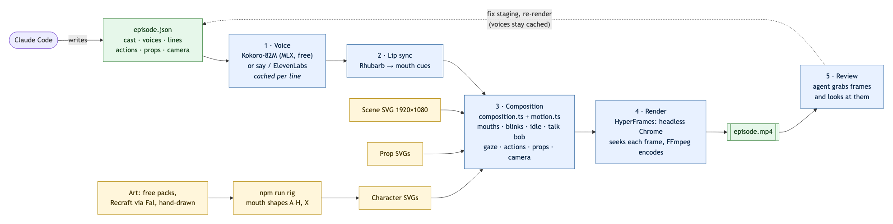
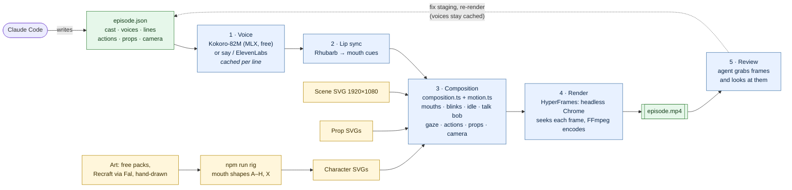

# Video pipeline

How an episode goes from a script to an MP4 with the headless renderer in `agent/`. For commands and the episode format, see [agent/README.md](../agent/README.md).

Mermaid source, which renders on GitHub and in most Markdown previews:

## Stages

| Stage | Code | Runs | Cost | Typical time |
|---|---|---|---|---|
| Voice | `agent/render-episode.ts`, `agent/kokoro_tts.py` | Kokoro on Apple Silicon via MLX, `say`, or the ElevenLabs API | Free locally | About 4 s for six Kokoro lines |
| Lip sync | `rhubarbCues()` in `agent/render-episode.ts` | Rhubarb 1.14.0 (Intel build, runs under Rosetta) | Free | About 4–7 s per line |
| Composition | `src/main/composition.ts`, `src/main/motion.ts`, `agent/episode-motion.ts` | Node, no browser | Free | Under 1 s |
| Render | HyperFrames CLI | chrome-headless-shell and FFmpeg | Free | About 35–60 s for a 30 s episode |

Everything an episode produces goes in `.agent-work/shows/<episode-slug>/`. The MP4 is written next to the episode file unless you pass `-o`.

## Why it's built this way

- **Every motion is on one seekable timeline.** HyperFrames renders by seeking the GSAP timeline to each frame, in parallel workers. Anything driven by real time (`requestAnimationFrame`, CSS animations, `Math.random`) would differ between workers and between renders, so motion uses seeded values and timeline tweens only. Two renders of the same episode give identical frames.
- **Electron stays out of the render path.** The desktop app's main-process code runs under plain Node through `agent/hooks.mjs`, which swaps in stubs for Electron's app paths and keychain settings. An agent can drive the whole pipeline from a shell.
- **Lines are cached.** Each line's audio and mouth cues are keyed by voice and text, so changing positions, actions or camera moves re-runs only the composition and the render.
